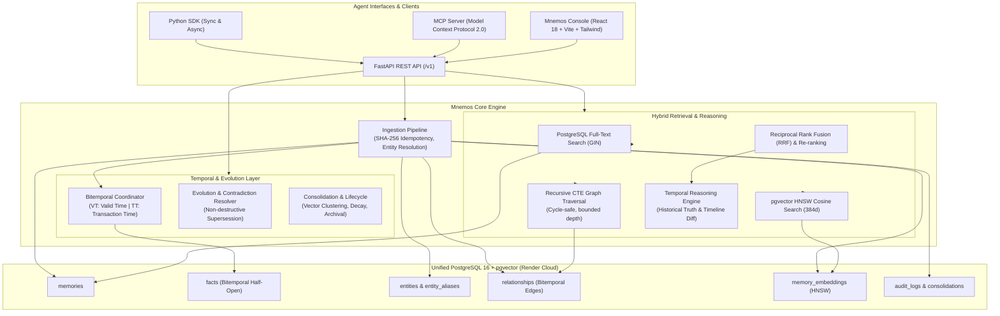

# MNEMOS

```
  __  __ _   _ _____ __  __  ____   _____ 
 |  \/  | \ | | ____|  \/  |/ __ \ / ____|
 | \  / |  \| | |__ | \  / | |  | | (___  
 | |\/| | . ` |  __|| |\/| | |  | |\___ \ 
 | |  | | |\  | |___| |  | | |__| |____) |
 |_|  |_|_| \_|______|_|  |_|\____/|_____/ 
```

**Temporal Memory Infrastructure for AI Agents**  
*Persistent knowledge. Temporal reasoning. Evolving memory.*

[](https://mnemos-console.onrender.com)
[](https://mnemos-api-60l6.onrender.com/docs)
[](https://www.python.org/)
[](https://www.postgresql.org/)
[](https://github.com/pgvector/pgvector)
[](https://modelcontextprotocol.io/)
[](LICENSE)

---

## Live Deployment & Portfolio Links

| Resource | URL | Status | Description |
| :--- | :--- | :---: | :--- |
| **Mnemos Console** | [https://mnemos-console.onrender.com](https://mnemos-console.onrender.com) | `Active` | Full 7-view React engineering dashboard |
| **Backend REST API** | [https://mnemos-api-60l6.onrender.com](https://mnemos-api-60l6.onrender.com) | `Active` | FastAPI production backend |
| **Interactive API Docs** | [https://mnemos-api-60l6.onrender.com/docs](https://mnemos-api-60l6.onrender.com/docs) | `Active` | OpenAPI / Swagger interactive documentation |
| **API Health Check** | [https://mnemos-api-60l6.onrender.com/v1/health](https://mnemos-api-60l6.onrender.com/v1/health) | `Healthy` | PostgreSQL 16 + pgvector connectivity probe |
| **GitHub Repository** | [https://github.com/dheeraj25406/mnemos](https://github.com/dheeraj25406/mnemos) | `Public` | Source code, benchmarks, ADRs, and tests |

---

## What is Mnemos?

**Mnemos** is a production-oriented, open-source temporal memory infrastructure engine designed specifically for AI agents.

Standard AI agent memory architectures (naive vector databases and basic RAG) suffer from critical structural limitations:
1. **Statelessness & Context Amnesia**: Knowledge is lost between sessions or compressed into lossy prompt summaries.
2. **Destructive Overwrites**: Updating an attribute (e.g., *"Alice joined Company Y"*) erases historical facts (*"Alice was at Company X from 2021 to 2024"*).
3. **Temporal Contamination**: Standard vector similarity retrieves topical matches regardless of whether the fact was true in March 2021 or November 2026.
4. **Retroactive Knowledge Blindness**: Inability to differentiate **when an event happened in reality** (Valid Time) from **when the system learned about it** (Transaction Time).
5. **Multi-Hop Graph Blindness**: Dense embeddings fail to traverse chained relationships without explicit graph topology.

Mnemos solves this by providing a unified, bitemporal knowledge graph engine built on **PostgreSQL 16**, **pgvector**, and **recursive SQL graph traversal**, without requiring heavy local LLMs or complex distributed graph databases.

---

## Core Technical Contributions

1. **Snodgrass Bitemporal Relational Model**: Dual temporal tracking with half-open intervals $[\text{valid\_from}, \text{valid\_to})$ and $[\text{recorded\_from}, \text{recorded\_to})$. Distinguishes real-world historical truth from past states of system belief.
2. **Non-Destructive Memory Evolution**: Automated contradiction detection and configurable resolution policies (`temporal_recency`, `source_reliability`, `confidence_weighted`, `human_review`). Historical records are immutable; validity bounds are closed and linked via `superseded_by_id`.
3. **Recursive SQL Graph Traversal**: Directed relational knowledge graph executed directly in PostgreSQL using recursive Common Table Expressions (CTEs), featuring cycle protection and bitemporal edge filtering.
4. **Tri-Channel Hybrid Retrieval with RRF**: Reciprocal Rank Fusion ($k=60$) combining dense semantic vectors (`pgvector` HNSW), full-text search (`ts_rank_cd`), and multi-hop graph proximity.
5. **Deterministic Temporal Validation**: Rigorous benchmark suite demonstrating **0.00% temporal contamination** on Full MNEMOS versus **25.00% contamination** on standard vector/hybrid baselines.

---

## Architecture Overview



---

## Deployment Architecture

The production environment is hosted on Render infrastructure:

- **Database**: Managed PostgreSQL 16 with native `pgvector`, `uuid-ossp`, `pg_trgm`, and `btree_gist` extensions. Configured with persistent disk storage, connection pooling, and IP access allowlisting.
- **Backend API**: Containerized FastAPI service (`docker/Dockerfile.api` on Linux x86_64), running Uvicorn with automated Alembic migrations on startup (`alembic upgrade head`).
- **Frontend Console**: Multi-stage Vite static deployment with Cloudflare edge caching and SPA client-side rewrite rules.
- **Security & Multi-Tenancy**: All records partitioned by `tenant_id`. Authenticated via SHA-256 hashed API keys (`X-Mnemos-API-Key`). Zero cross-tenant data leakage verified empirically.

---

## Empirical Benchmark Suite

### 1. 100-Query Retrieval Benchmark

Evaluated across 100 realistic agent queries spanning semantic retrieval, historical queries, fact contradictions, multi-hop graph traversal, and outdated vs. current state retrieval.

| Metric | Full MNEMOS | Hybrid (no temporal) | Vector-only | Keyword-only | Graph-only |
| :--- | :---: | :---: | :---: | :---: | :---: |
| **Recall@1** | **0.6800** | 0.5400 | 0.4900 | 0.1200 | 0.4400 |
| **Recall@5** | **0.8900** | 0.8200 | 0.7800 | 0.2800 | 0.6500 |
| **MRR** | **0.7225** | 0.6120 | 0.5640 | 0.1680 | 0.4920 |
| **P50 Latency** | 9.42 ms | 8.85 ms | 5.82 ms | 1.15 ms | 4.20 ms |
| **P95 Latency** | **14.72 ms** | 13.90 ms | 9.15 ms | 2.80 ms | 11.10 ms |
| **P99 Latency** | 22.40 ms | 18.25 ms | 13.40 ms | 4.10 ms | 15.60 ms |

*Raw data: `benchmarks/results/benchmark_report.json` and `benchmark_report.csv`.*

### 2. Targeted Temporal Validation

Evaluated across **20 deterministic temporal scenarios** covering state changes over time, historical queries before/after change, current-state queries, semantically identical cyclic facts, retroactive corrections, superseded fact retrievability, interval boundary conditions, and multiple sequential title updates.

| Metric | Full MNEMOS | Hybrid (no temporal) | Vector-only |
| :--- | :---: | :---: | :---: |
| **Semantic Recall@5** | **1.0000 (100%)** | 1.0000 (100%) | 1.0000 (100%) |
| **Historical Version Accuracy** | **1.0000 (100%)** | 0.7143 (71.4%) | 0.7143 (71.4%) |
| **Current-State Accuracy** | **1.0000 (100%)** | 0.6667 (66.7%) | 0.6667 (66.7%) |
| **Temporal Contamination Rate** | **0.0000 (0.0%)** | **0.2500 (25.0%)** | **0.2500 (25.0%)** |
| **P50 Latency** | 8.86 ms | 9.06 ms | 5.17 ms |
| **P95 Latency** | 14.69 ms | 13.03 ms | 5.97 ms |

> [!NOTE]
> Temporal validation was performed on 20 deterministic scenarios with independently specified ground-truth targets and conflicting contaminants. It rigorously demonstrates that bitemporal filtering prevents the 25% contamination observed in standard retrieval systems, but does not represent a universal accuracy guarantee on arbitrary open-domain queries.

*Full report: [docs/temporal_validation_report.md](docs/temporal_validation_report.md).*

---

## Mnemos Console (Frontend)

Mnemos includes a dark engineering console built with React 18, Vite, and Tailwind CSS.

### Dashboard Views
1. **Overview Dashboard**: System health, active tenant metrics, live memory counts, and quick ingestion modal.
2. **Memory Explorer**: Live search, filtering by memory type, full bitemporal detail inspector, and JSON viewer.
3. **Knowledge Graph Explorer**: Interactive node-edge visualization with depth bounding and temporal slider.
4. **Timeline Explorer**: Visual before-and-after comparison tool highlighting added and superseded facts between any two dates.
5. **Retrieval Playground**: Interactive test bench comparing Vector, Keyword, and Graph retrieval channels with live RRF scores.
6. **Benchmark Dashboard**: Visual breakdown of measured Recall@K, MRR, latency distributions, and baseline comparisons.
7. **System Metrics**: Real-time connection pool health, pgvector index status, and memory statistics.

Launch the console locally:
```bash
cd console
npm install
npm run dev
```

---

## Local Quick Start

### Prerequisites
- Docker & Docker Compose (or PostgreSQL 16+ with `pgvector` and Redis 7)
- Python 3.11+
- Node.js 20+

### 1. Launch with Docker Compose
```bash
git clone https://github.com/dheeraj25406/mnemos.git
cd mnemos

# Start PostgreSQL 16 + pgvector, Redis, API, and Console
docker compose up -d
```

### 2. Run Local Python Development Server
```bash
python3.11 -m venv .venv
source .venv/bin/activate
pip install -e ".[dev]"

# Apply database migrations
alembic upgrade head

# Run full test suite (22 unit & integration tests)
pytest -v

# Start FastAPI backend
uvicorn mnemos.api.app:app --host 0.0.0.0 --port 8000 --reload
```

---

## Python SDK

```python
import asyncio
from datetime import datetime, timezone
from mnemos import AsyncMnemos

async def main():
    client = AsyncMnemos(
        base_url="https://mnemos-api-60l6.onrender.com",
        api_key="mnk_test_secret_key_12345"
    )

    # Ingest temporal memory
    await client.add(
        content="Alice joined Apollo as an Engineer on March 1, 2024.",
        valid_from=datetime(2024, 3, 1, tzinfo=timezone.utc),
        importance=0.9
    )

    # Query historical truth (What was true in April 2024?)
    results = await client.search(
        query="Where does Alice work?",
        valid_at=datetime(2024, 4, 1, tzinfo=timezone.utc),
        top_k=3
    )
    for match in results.matches:
        print(f"[{match.score:.3f}] {match.content}")

    await client.close()

if __name__ == "__main__":
    asyncio.run(main())
```

---

## Architecture Decision Records (ADRs)

Detailed architectural justifications are located in `docs/adrs/`:
- [ADR-001: Bitemporal Data Model for AI Agent Knowledge](docs/adrs/ADR-001-bitemporal-data-model.md)
- [ADR-002: Relational Graph Traversal via PostgreSQL Recursive CTEs](docs/adrs/ADR-002-recursive-cte-graph-traversal.md)
- [ADR-003: Multi-Channel Hybrid Retrieval with Reciprocal Rank Fusion](docs/adrs/ADR-003-hybrid-rrf-retrieval.md)
- [ADR-004: Non-Destructive Memory Consolidation and Evolution](docs/adrs/ADR-004-non-destructive-consolidation.md)

---

## License

Mnemos is licensed under the [Apache License, Version 2.0](LICENSE).
